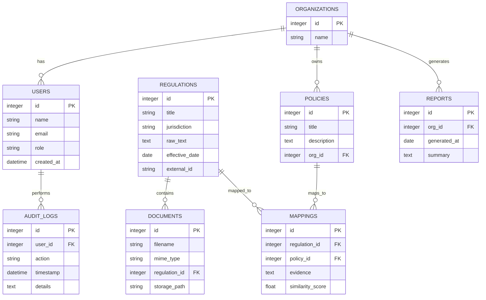

# RegIntel Unisys — Interview & Project Guide

## Elevator pitch
RegIntel Unisys is an AI-driven intelligent regulatory compliance system that uses a multi-agent pipeline to ingest, analyze, and operationalize regulatory content. It provides a modern dashboard interface for compliance teams to track regulations, map them to internal policies, generate compliance reports, and receive recommended actions.

Use this file during campus placement interviews to describe the project, the architecture, key design choices, and to practice answering likely questions.

---

## Key features
- Multi-agent pipeline for document ingestion, semantic parsing, and policy mapping
- Automated entity extraction and regulation-to-policy linkage
- Interactive dashboard for visualization, filtering, and drill-down
- Versioned regulatory documents, audit logs, and compliance reporting
- Extensible architecture: plug in new agents (NLP models, rule engines)

---

## Tech stack (based on repo language composition)
- Frontend: JavaScript (React or similar) + CSS for dashboard UI
- Backend/agents: Python for ML/NLP agents and orchestration
- Integration: REST APIs / WebSockets between backend and frontend
- Storage: relational DB for metadata and documents, object store for raw documents

---

## Architecture (high level)

Mermaid flowchart (renderable on GitHub that supports Mermaid):

```mermaid
flowchart TD
  A[Documents (PDF, HTML, Word)] -->|Ingest| B[Preprocessing Agent]
  B --> C[Extraction Agent]
  C --> D[Semantic Index & Vector DB]
  D --> E[Policy Mapping Agent]
  E --> F[Compliance Rules Engine]
  F --> G[Report Generator]
  G --> H[Dashboard/UI]
  subgraph Ops
    I[Auth] --> H
    J[Audit Logs] --> G
  end
```

If Mermaid isn't available, here's a simple ASCII diagram:

Documents --> Preprocessing --> Extraction --> Vector DB --> Policy Mapping --> Rules Engine --> Reports --> Dashboard

---

## Multi-agent pipeline (details)
- Preprocessing agent: normalizes documents, OCR for scanned PDFs, language detection.
- Extraction agent: uses NLP (NER, relation extraction) to pull out regulation numbers, sections, obligations, effective dates.
- Vector/semantic index: stores embeddings to enable semantic search and similarity matching.
- Policy mapping agent: matches extracted regulation items to internal policies using embeddings + rule-based heuristics.
- Rules engine: evaluates policy compliance status, computes gaps, and triggers remediation tasks.
- Report generator: creates PDF/HTML/JSON reports and populates dashboard widgets.

---

## Data model / ER Diagram

Mermaid ER diagram:



ASCII-style ER brief:
- Users (1..n) belong to Organizations
- Organizations (1..n) have Policies and Reports
- Regulations (1..n) have Documents
- Regulations and Policies are linked via Mappings that include evidence and similarity score

---

## How to explain in an interview (concise script)
1. Problem: Compliance teams need to continuously track changing regulations and map them to internal policies — manual work is slow and error-prone.
2. Solution: RegIntel Unisys automates ingestion, semantic understanding, mapping, and reporting using a multi-agent architecture and an interactive dashboard.
3. Impact: Faster mapping, traceable evidence, centralized audit logs, and actionable dashboards for stakeholders.
4. Role & contributions: (Customize with your responsibilities: e.g., built extraction agent, implemented frontend dashboard, integrated vector DB, or wrote CI/CD pipelines.)

---

## Possible interview questions and suggested talking points

System design / architecture
- Q: How does your system handle large volumes of regulatory documents and scale?
  - A: Explain preprocessing parallelism, chunking documents, using a vector DB for retrieval, horizontally scaling agents (worker queue like Celery/RQ), and using object storage for raw files.

- Q: How do you ensure correctness when mapping regulations to policies?
  - A: Combine semantic similarity (embeddings) with rule-based checks, confidence thresholds, human-in-the-loop verification, and store evidence with mappings for auditability.

- Q: How would you design the audit log and data retention for compliance?
  - A: Immutable append-only logs, link logs to user IDs and actions, sign or checksum critical records, and provide retention policies configurable per org.

Machine Learning / NLP
- Q: What NLP techniques are used for extraction?
  - A: OCR when needed, tokenization, NER for entities (regulation numbers, dates), relation extraction for obligations, embeddings (sentence/paragraph) for semantic matching, and fine-tuning when required.

- Q: How do you evaluate mapping model quality?
  - A: Precision/recall on a labeled mapping dataset, human review for edge cases, mean reciprocal rank (MRR) for retrieval tasks, and A/B testing in production.

Frontend / UX
- Q: How did you design the dashboard for compliance users?
  - A: Focus on quick filtering (by org, jurisdiction, risk level), drill-down evidence panels, clear timelines for regulatory changes, and exportable reports.

Security & Privacy
- Q: How are sensitive documents protected?
  - A: Access control by org/role, encryption at rest and in transit, least privilege, and session auditing.

Operational
- Q: How do agents communicate and how is work coordinated?
  - A: Use a message queue (RabbitMQ, Kafka) or task queue (Celery) for job dispatch; each agent is a worker that claims tasks and writes results to the DB and object store.

Behavioral
- Q: Tell me about a challenge and how you solved it.
  - A: Use the STAR format: Situation, Task, Action, Result. Example: dealing with noisy OCR output — solution combined heuristics and lightweight language-model based corrections, improving structured extraction accuracy by X%.

---

## Sample short answers (practice)
- "What is the hardest technical part of the project?"
  - Building a robust extraction pipeline that tolerates noisy input (scanned PDFs) and maps diverse legal language consistently to internal policies.

- "Why multi-agent?"
  - Agents let you separate concerns, scale independently, and iterate on individual capabilities (e.g., swapping a new extraction model without touching the rules engine).

---

## Demo checklist (what to show in 10 minutes)
1. Quick elevator pitch (30s)
2. Show dashboard landing page: org overview & active compliance issues (1 min)
3. Open a regulation detail: highlight parsed sections and extracted obligations (2 min)
4. Show a regulation→policy mapping with evidence and similarity score (2 min)
5. Generate/export a short compliance report (1 min)
6. Briefly show logs/trace for an action proving auditability (1 min)

---

## How to present your role
- Be specific: mention components, languages, libraries, and any measurable impact.
- If you worked on model training: mention dataset size, evaluation metrics, and tooling (e.g., Hugging Face, scikit-learn).
- If you worked on frontend: highlight performance improvements, accessibility considerations, and UX tests.

---

## Appendix: Useful commands / dev tips (generic)
- Start backend dev server: `python -m venv .venv && source .venv/bin/activate && pip install -r requirements.txt && python app.py` (adjust to repo specifics)
- Start frontend: `npm install && npm start` or `yarn && yarn start`
- Run tests: `pytest` or `npm test`

---

## Notes & customization
- Replace the generic role/contribution placeholders with your actual responsibilities and numbers (e.g., reduced manual mapping time by 60%).
- If you want, I can add a diagram image file (PNG/SVG) or update this guide to include repo-specific commands after I inspect the repository layout.

---

Good luck with your campus placement interviews — tell the story of the problem, your technical approach, and the impact you created.
